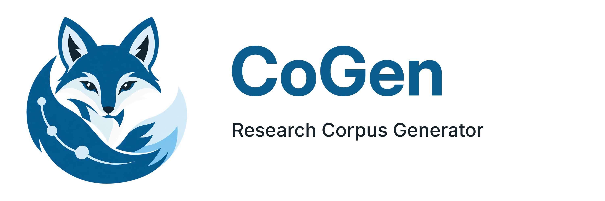

# CoGen - Corpus Generator



CoGen is a Go-based research-corpus pipeline that turns literature exports from Scopus, IEEE Xplore, and Web of Science into an immutable, provenance-rich SQLite corpus. It deduplicates articles, enriches them through Crossref, OpenAlex, and ORCID, validates and normalizes metadata, and records every step as content-addressed artifacts and append-only audit events. A loopback-only local viewer lets you browse the corpus and record run-scoped reviews, versioned notes, links, and PDF anchors.

## Quick start

Requirements: Go 1.25+ and Node.js 22.18+ (the viewer and frontend need Node and npm).

```sh
make frontend-install # install the locked npm workspaces
make build           # build the pipeline binary
make run             # run the configured workspaces (creates corpus.metadata.db)
make frontend-build  # assemble the viewer assets
make serve DB=corpus.metadata.db
```

Open `http://127.0.0.1:8080` in a browser. To preview the viewer without pipeline data, run `make dev` instead.

`make run` reads the export files declared in `config/workspace.something`. Put your Scopus and IEEE Xplore CSV exports and your Web of Science BibTeX export in `corpus/`, and point each source's `expected_file` at them. Run `make help` for every target, variable, and example.

## What CoGen does

- Ingests Scopus and IEEE Xplore CSV exports and Web of Science BibTeX exports.
- Deduplicates, enriches, validates, and normalizes article metadata.
- Persists an immutable SQLite corpus with content-addressed artifacts and append-only audit events.
- Serves a loopback-only viewer for browsing evidence and recording run-scoped reviews.

## Repository layout and tests

`backend/` owns Go production code, `frontend/` owns browser product source and assets, `tooling/` owns Go and Node developer tools, and `internal/` owns shared Go primitives. Tests and fixtures live under `tests/<domain>/<component>/<layer>/`; the repository has one root Go module and one root npm workspace with a single lockfile. Generated assets, disposable databases, reports, and E2E bundles live under `build/`.

```sh
make test                                      # all ordinary Go, Node, and browser suites
make test DOMAIN=backend LAYER=unit COMPONENT=database/run
make test-go COMPONENT=server LAYER=integration
make test-frontend-unit
make test-frontend-functional
make test-frontend-all WORKERS=2
make test DOMAIN=contracts COMPONENT=http BROWSER=all
make test-e2e                                  # explicit offline pipeline-to-viewer flow
```

Live-provider checks require the separate `make test-e2e-live E2E_LIVE=1` opt-in and remain outside ordinary tests, race, and coverage.

## Documentation

In-depth guides are planned for the project wiki. Until it exists, the authoritative documents live under `docs/`:

- [docs/PROJECT-USAGE.md](docs/PROJECT-USAGE.md) - developer and operator workflows.
- [docs/APP-USAGE.md](docs/APP-USAGE.md) - viewer usage, note syntax, and review workflow.
- [docs/ARCHITECTURE.md](docs/ARCHITECTURE.md) - system structure and behavior.

## Requirements

- Go 1.25.0 or a compatible later toolchain for the backend, tooling, tests, and builds.
- Node.js 22.18 or later and npm for the frontend, unit tests, and Playwright browser tests.

## License

MIT. See [LICENSE](LICENSE).
